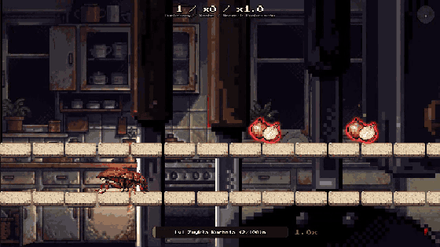

# Karaluch

A multiplayer browser game where you are a cockroach and everything is trying to kill you.

**[Play it](https://cockroach.wszystko.app)** in your browser or on your phone. The game is in Polish.



Run through ten levels, dodge obstacles, grab pickups and, if you survive long enough, fight a three-headed boss. Play alone or with friends in the same run: every player gets the same seed, so everyone sees the same level without the server sending it.

Built with TypeScript, Phaser 3, Node, Socket.IO and SQLite.

## Controls

| Key | Action |
|---|---|
| `↑`, `↓` | Hop to the top lane, drop to the bottom lane |
| `→` | Dash |
| `Space` | Shoot (boss fight) |

## Run it

```bash
npm install
npm run dev    # http://localhost:5678
```

## License

The code is MIT. The art, music and sound effects are not licensed for reuse. See [LICENSE](LICENSE).

## Sound credits

Most sound effects are synthesised by `tools/audio`, some layered with samples from CC0 packs (Kenney, OpenGameArt authors). What came from where, with links and licence evidence: [docs/SOUND_CREDITS.md](docs/SOUND_CREDITS.md).
