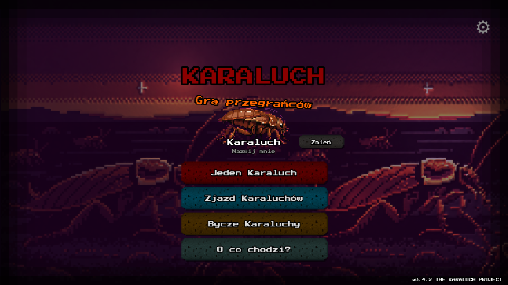

# Karaluch

**A multiplayer browser game where you are a cockroach and everything is trying to kill you.**

Run across ten increasingly unhinged levels, dodge onions, grab rotten apples, and meet a three-faced boss
at the end. Then do it again with your friends, live, in the same run.

**[Play it now](https://cockroach.wszystko.app)** (no install, works on phones, the game is in Polish)


## What's in it

- **Singleplayer:** an endless side-scroller with ten levels, each with its own parallax art and soundtrack.
- **Multiplayer:** lobbies, live ghost players, spectating when you die, and a shared scoreboard.
- **Boss fight:** a co-op fight where one client runs the boss and hands it over if that player drops.
- **Mobile first:** touch controls, and a full game that loads over 4G.

| Key | Action |
|---|---|
| `Space`, `↑`, `↓` | Swap lanes |
| `Shift` | Dash |

On a phone, the screen splits into swap and dash touch zones.

## How multiplayer stays in sync

Sending every obstacle over the network would be slow and easy to desync, so nothing is sent.

The server gives each lobby one seed. Every client feeds it into the same [Mulberry32](src/multiplayer/SeededRNG.ts)
generator, so all players build an identical level on their own machine. Only player actions travel over
Socket.IO: lane swaps, dashes, pickups, deaths and periodic position updates.

Other players are ghosts. Each one simulates locally with the same speed formula as the player, and position
updates correct any drift. Cosmetic effects like particles never touch the seeded generator: a single extra
call on one machine would shift the sequence and split the world between players.

The boss fight works the same way, with one player as host. The server validates who that is and moves the
role to another player if they leave.

## Getting it to look and run right

- **Lighting:** parallax layers use normal maps with Phaser's Light2D pipeline, so flat pixel art reacts to light.
- **Assets:** images are lossless WebP and soundtracks are 96 kbps, taking the download from 17 MB to 10.6 MB.
- **Audio:** every track is loudness-normalised to EBU R128 targets, so music, effects and ambience stay balanced.
- **Caching:** hashed bundles are cached forever, while everything else revalidates so new art shows up straight away.

## Stack

TypeScript, Phaser 3, Vite, Node, Express, Socket.IO, SQLite (better-sqlite3), Docker.

```
src/
  scenes/        Menu, game, lobby and game-over scenes
  systems/       Dash, pills, game over, boss and other gameplay systems
  multiplayer/   Socket client, seeded RNG, ghost players
  objects/       Player and obstacle spawning
server/
  multiplayer.ts Lobby and game events
  lobby.ts       Lobby state
  db.ts          Scoreboard
```

## Running it

```sh
npm install
npm run dev          # game on http://localhost:5678, server on :3456
```

To test multiplayer alone, start the server with `DEBUG_BOT=1` and create a lobby under the name `debug`:
a bot joins and plays with you.

```sh
npm test             # unit tests for the seeded RNG and lobby rules
npm run typecheck
npm run build        # production client
npm run server:build # production server, then npm start
```

Or with Docker:

```sh
docker build -t karaluch .
docker run -p 3000:3000 -v karaluch-data:/data karaluch
```



## License

The code is MIT. The artwork, music and sound effects are not licensed for reuse. See [LICENSE](LICENSE).
